# Manual de usuario · CRM Zimbra (HU-46)

## 1. Instalación rápida

```bash
cp .env.example .env
docker compose up -d --build
```

| Servicio | Dirección |
|---|---|
| Aplicación web | http://localhost:5174 |
| API (Swagger) | http://localhost:8000/docs |
| Salud de la API | http://localhost:8000/api/v1/health |
| MySQL | localhost:3307, usuario `root`, sin contraseña |
| Correos enviados (Mailpit) | http://localhost:8025 |

Sin Docker: ver el README (MySQL en Docker, backend con `uvicorn`, frontend con `npm run dev`).

## 2. Usuarios de prueba

Contraseña de todos: `Zimbra2026*`

| Rol | Correo | Qué puede hacer |
|---|---|---|
| Admin | camila.rojas1@zimbra-demo.com | Todo, incluida la gestión de empleados y productos |
| Marketing | valentina.bermudez3@zimbra-demo.com | Campañas, prospectos, pruebas, visitas, reportes (lectura de ventas/propuestas) |
| Vendedor | carlos.salazar6@zimbra-demo.com | Solo sus prospectos, alertas, interacciones, propuestas y ventas |

La sesión se cierra tras 30 minutos sin actividad.

## 3. Flujo de uso (paso a paso)

El sistema tiene dos tipos de personas:

- **Visitantes:** prueban Zimbra. No tienen usuario: se registran en el sitio público y entran a su página «Mi prueba» con el enlace que les llega por correo.
- **Equipo comercial:** Admin, Marketing y Vendedor. Entran al CRM en `/login` con correo y contraseña.

### 3.1 El visitante

**Sitio público.** Explica el producto, los planes (en pesos colombianos) y las preguntas frecuentes.

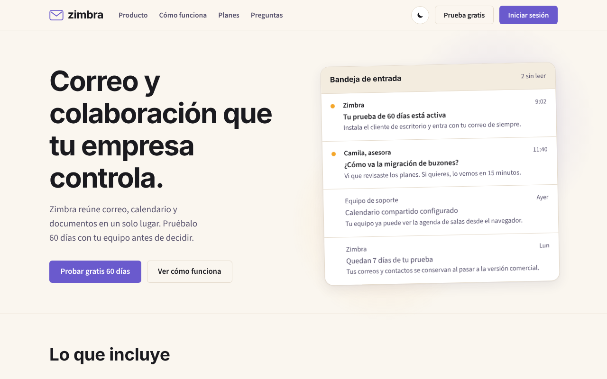

**Activar la prueba.** El visitante elige qué probar; cada opción explica para qué sirve. Deja su nombre y su correo, y el sistema ejecuta la transacción T1: crea el prospecto, registra la prueba de 60 días y suma 20 puntos. Le llegan dos correos: bienvenida y prueba activada.

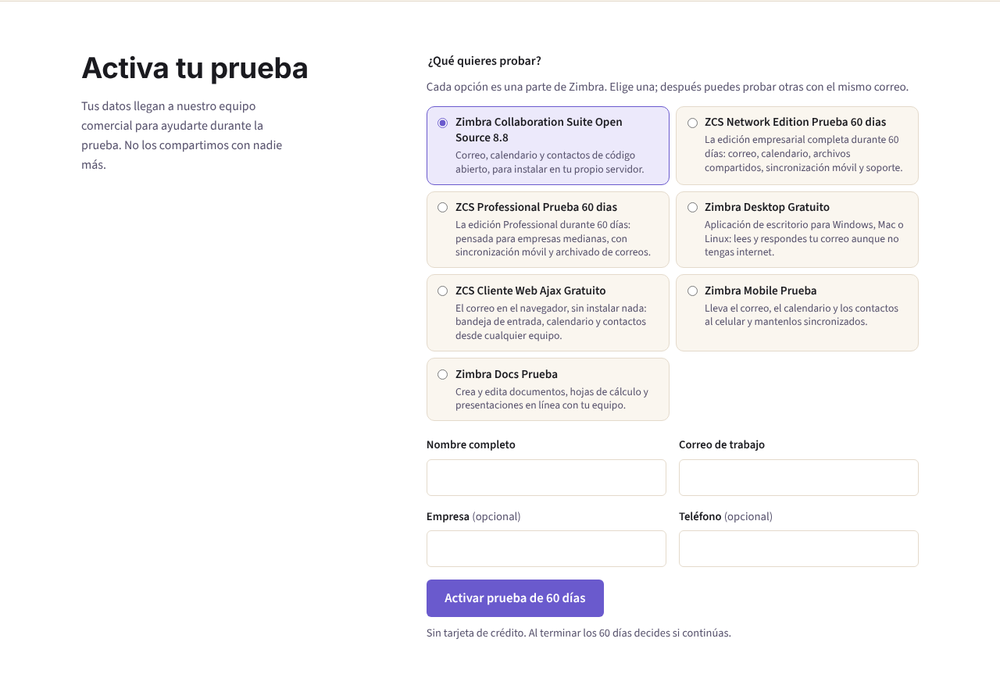

**Mi prueba.** El enlace del correo abre su página personal: días restantes, cómo empezar y quién es su asesor. Abrir la página y pulsar **Ver planes y precios** cuentan como visitas web (T2) y suben su puntaje. Cuando llega a 50 pasa a *Calificado*, y su vendedor recibe una alerta.

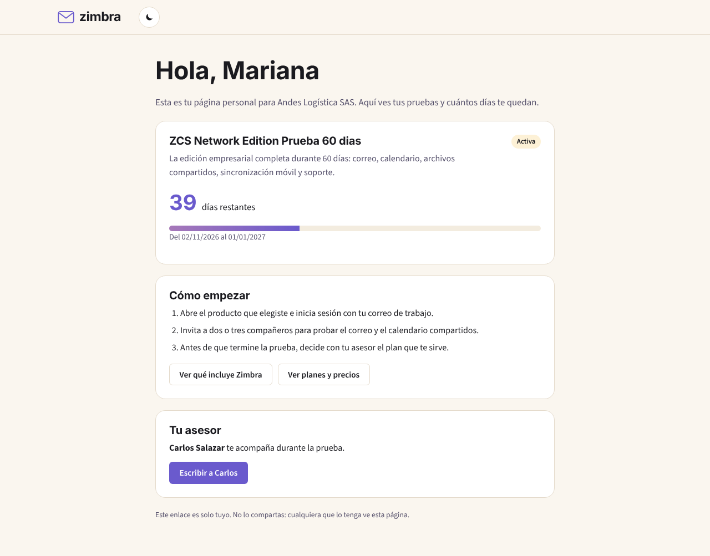

### 3.2 El equipo comercial

1. **Iniciar sesión** con el correo y la contraseña. Un dato errado muestra «Correo o contraseña incorrectos». Si la olvidaste, **¿Olvidaste tu contraseña?** envía un enlace al correo de la cuenta (en local se ve en http://localhost:8025).

   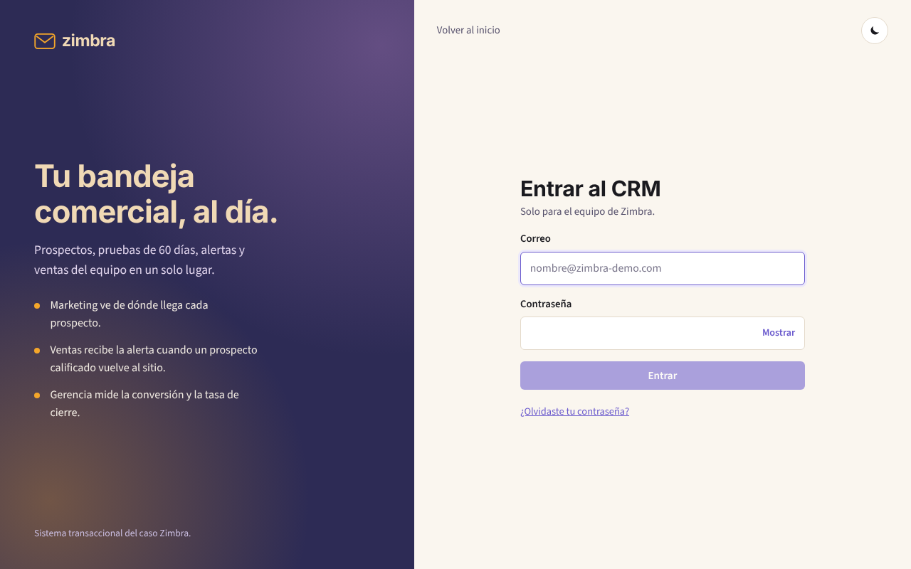

2. **Panel de inicio:** indicadores según el rol (RF-46).

   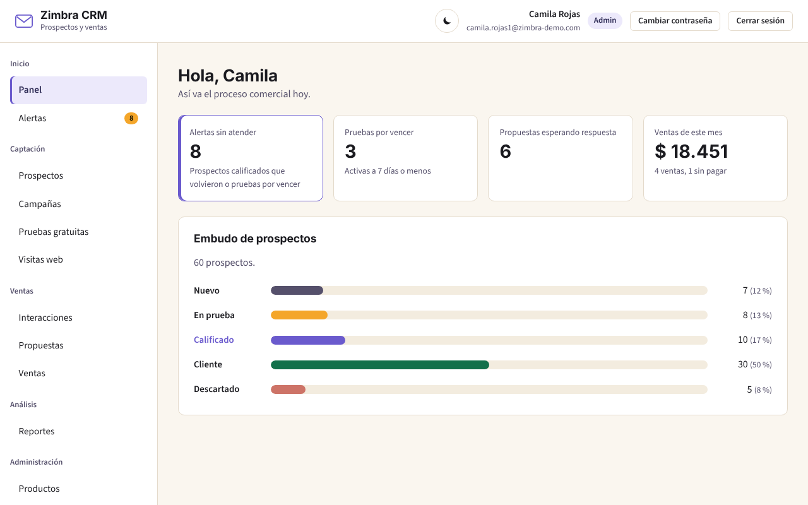

3. **Prospectos → Nuevo prospecto.** Nombre, correo (único), empresa, teléfono y campaña de origen. El listado busca por nombre, empresa o correo y filtra por estado, campaña y vendedor, de a 20 por página.

   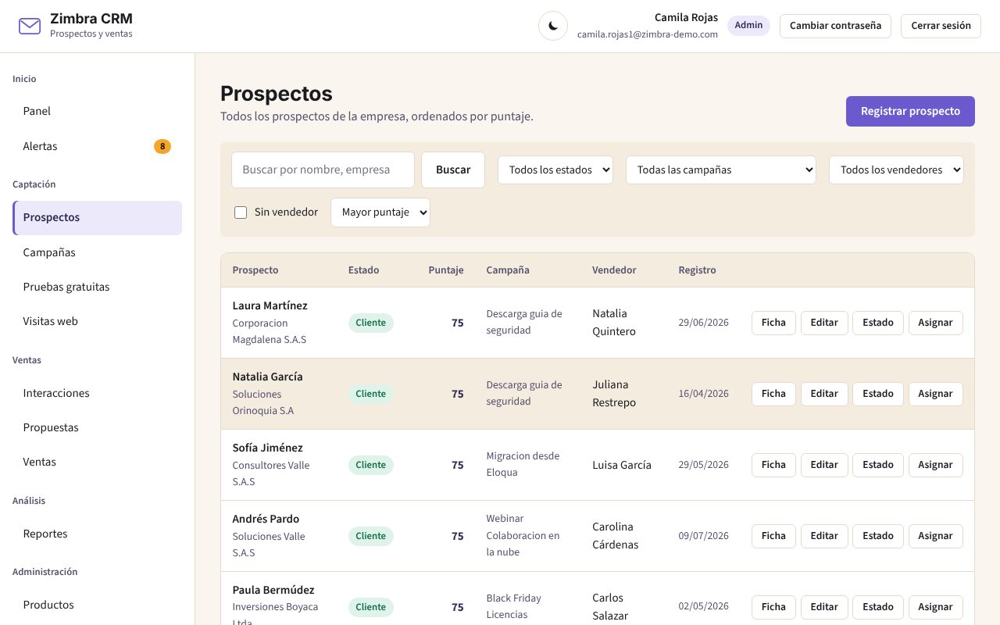

4. **Ficha del prospecto.** Todo su historial en una pantalla: puntaje, pruebas, visitas, alertas, interacciones, propuestas y venta (RF-10).

   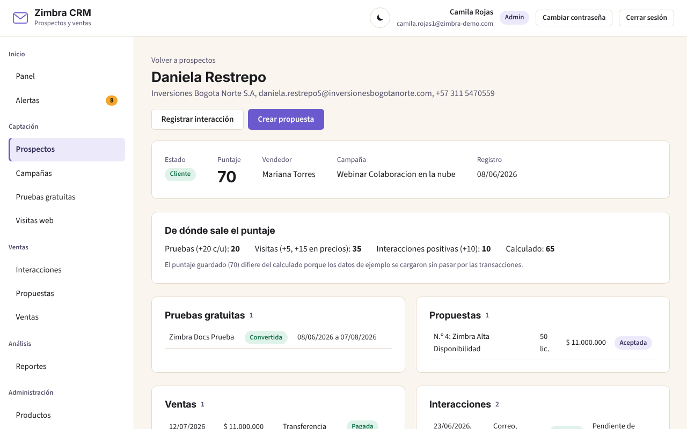

5. **Pruebas gratuitas → Registrar descarga.** Elige un producto de versión Gratuita. Suma 20 puntos y el prospecto pasa a *En prueba*; la prueba dura 60 días calculados por la base de datos. Un evento de MySQL vence cada noche las pruebas que terminaron.
6. **Visitas web → Simular visita.** Cada visita suma 5 puntos (+15 si es `/precios`). Al llegar a 50 puntos el prospecto es *Calificado*. Si ya está calificado y tiene vendedor, se crea una alerta (máximo una por hora).

   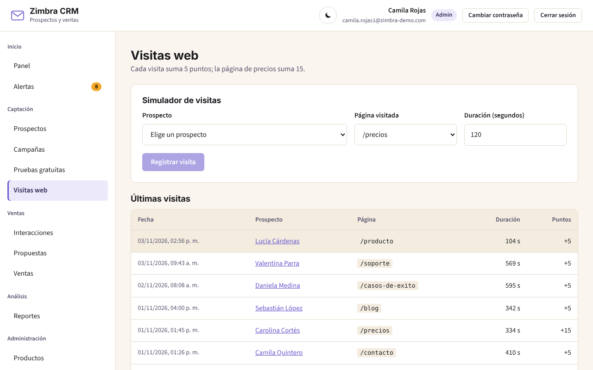

7. **Alertas.** El vendedor ve su bandeja (las más recientes primero, con teléfono) y marca como atendida.

   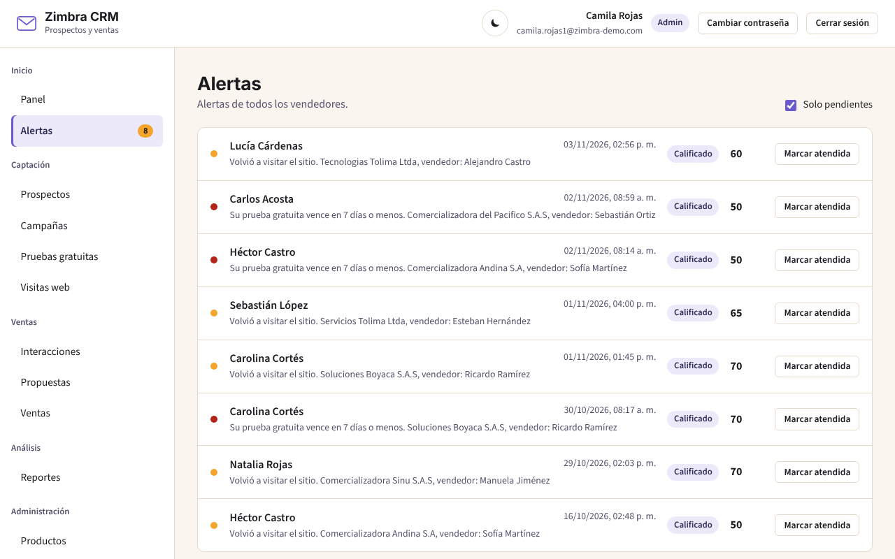

8. **Interacciones.** Registrar llamada o correo; un resultado *Positivo* suma 10 puntos.
9. **Propuestas.** Producto Comercial y número de licencias; el valor lo calcula la base de datos. Cambiar el estado a *Aceptada* o *Rechazada* (no se puede revertir). Filtros por estado, prospecto y fechas.

   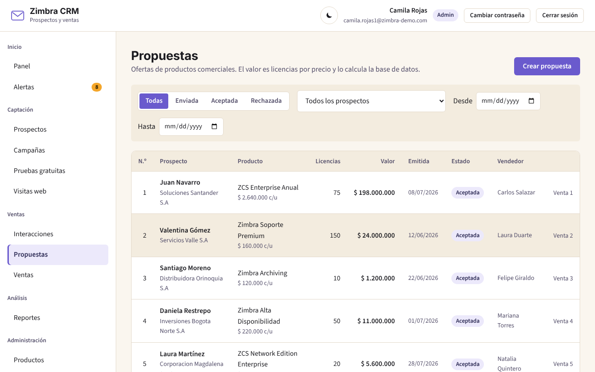

10. **Ventas → Registrar venta** desde una propuesta *Aceptada*. El prospecto pasa a *Cliente* y su prueba a *Convertida*. El Admin la marca *Pagada*. Filtros por fechas, vendedor y estado de pago.

    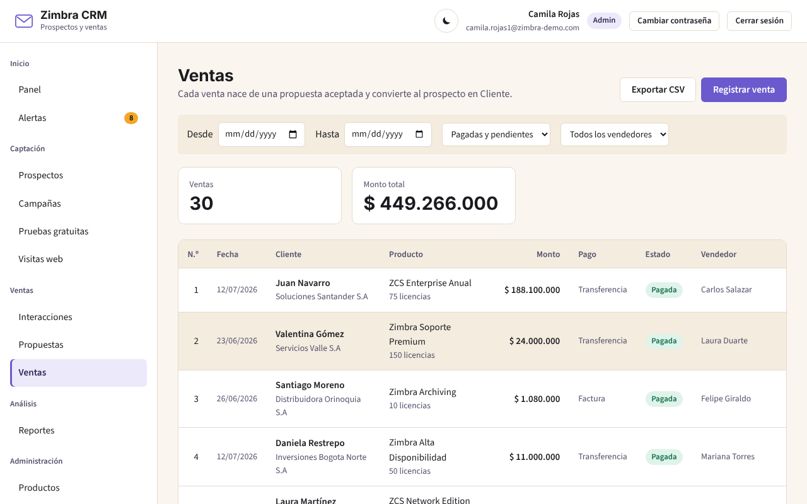

11. **Reportes:** ventas del mes, embudo, resumen anual, conversión, campañas, tasa de cierre y vistas SQL. Cada tabla se exporta a CSV. El vendedor ve solo sus ventas y su embudo.

    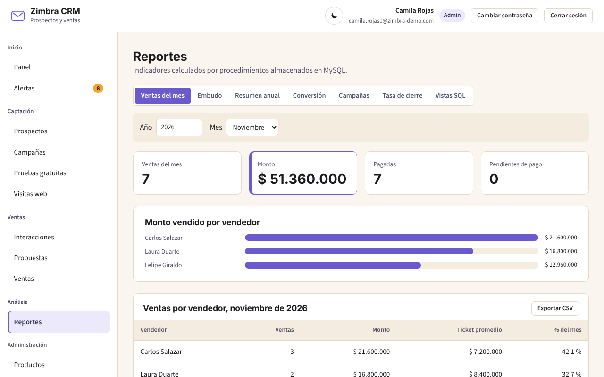

## 4. Mensajes de error frecuentes

| Mensaje | Causa |
|---|---|
| T1: el prospecto ya tiene una prueba Activa de este producto (RN-03) | Segunda prueba activa del mismo producto |
| TR-01: solo se registran pruebas de productos de version Gratuita. | Producto Comercial en una descarga |
| TR-02: solo se crean propuestas con productos de version Comercial (RN-07). | Propuesta con producto Gratuito |
| TR-03: una propuesta Aceptada o Rechazada no se puede modificar. | Reabrir propuesta cerrada |
| T4: solo una propuesta Aceptada puede convertirse en venta. | Venta de una propuesta Enviada |
| T4: la propuesta ya tiene una venta registrada. | Segunda venta de la misma propuesta |
| T5: solo se puede asignar a un Vendedor activo. | Reasignar a un vendedor inactivo |
| TR-07: una venta Pagada no puede volver a Pendiente. | Retroceder un pago |

## 5. Permisos que conviene conocer

- **Marketing** ve interacciones, propuestas y ventas en modo consulta: registrarlas es del Vendedor (o Admin).
- **Registrar visitas** es de Marketing y Admin (simulan el rastreo web).
- El **Vendedor** solo ve y edita lo que está asignado a él (RN-12).

## 6. Respaldo y restauración (RNF-13, HU-45)

Con el contenedor `zimbra_mysql` encendido:

```powershell
.\DB\respaldo\respaldo.ps1                       # crea DB\respaldo\copias\crm_zimbra_FECHA.sql
.\DB\respaldo\restaurar.ps1 -Archivo .\DB\respaldo\copias\crm_zimbra_FECHA.sql
```

En Linux/macOS: `sh DB/respaldo/respaldo.sh` y `sh DB/respaldo/restaurar.sh archivo.sql`.
La copia incluye tablas, datos, triggers y procedimientos (`--routines --triggers`).
Para comprobar la restauración: `GET /api/v1/health` debe mostrar 11 tablas de datos, 8 triggers y 14 procedimientos.

## 7. Pruebas

| Qué | Cómo |
|---|---|
| Transacciones y triggers (ACID) | `DB/pruebas/08_pruebas_transacciones.sql`, por bloques |
| API automatizada | `cd backend && pip install -r requirements-dev.txt && pytest -v` |
| Recorrido completo (crea datos) | `docker compose exec backend python scripts/probar_api.py` |
| Rendimiento con 10 000 prospectos | `DB/pruebas/09_carga_10000_prospectos.sql` |

## 7b. Sesión 4: vistas, índices, roles y concurrencia

- Vistas: `DB/08_vistas.sql`; en la app, Reportes → pestaña **Vistas SQL**.
- Índices: `DB/09_indices.sql`; demostración con `DB/pruebas/10_explain_indices.sql`.
- Roles de MySQL: `DB/10_roles_permisos.sql` (usuarios `crm_admin`, `crm_app`, `crm_marketing`, `crm_vendedor`, `crm_auditor`); prueba en `DB/pruebas/12_prueba_permisos.sql`. Para que la API use el usuario de mínimo privilegio, poner `DB_USER=crm_app` y `DB_PASSWORD=App#2026` en el `.env` (no probado con todos los endpoints).
- Concurrencia: `DB/pruebas/11_concurrencia.sql` y `python scripts/simular_concurrencia.py`.

## 8. Seguridad (nota para producción)

Cambiar `SECRET_KEY`, definir contraseña de MySQL y **eliminar** `DB/04_create_admin_user.sql`, que crea un usuario MySQL `admin/admin` solo apto para el taller.
